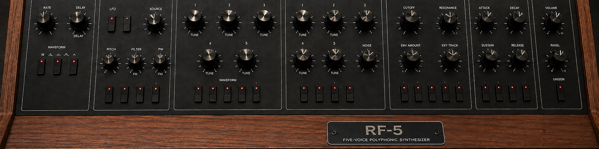

# RF-5

RF-5 is a five-voice analog-modelled polysynth for RackForge. Two oscillators, a resonant low-pass filter and separate envelopes for the filter and amplifier make it easy to move from a soft pad to a sharp brass sound.

## Install

RF-5 is included in the RackForge Standard bundle. To install it separately, download `RF-5.rfplugin` and choose **Install plugin** in RackForge's **Plugin Manager**. [Download RF-5](https://github.com/kalexis1994/rackforge-plugin-rf-5/releases/latest)

## Find a starting sound

Open **RF-5** in PLAY and browse the 120 Rev 3 factory programs across **RF-5 Original 40**, **RF-5 File 2** and **RF-5 File 3**.

- **1-1 Brass** lets you hear the filter opening with each note.
- **1-2 Low Strings** is a starting point for sustained chords. Lengthen the amplifier release to let the chords overlap.
- **1-3 Muted Clavinet** gives you a short attack for rhythmic playing.

## Work the panel

| Control | What you hear |
| --- | --- |
| **Oscillator A / B** | Blend the two oscillators in the mixer. Tune B slightly away from A for slow beating, or shift it by an interval. |
| **Sync** | Oscillator B resets A. Sweep A's frequency with sync on to change its timbre while B sets the pitch. |
| **Poly Mod** | Use oscillator B or the filter envelope to move the pitch, pulse width or filter, depending on the destination you select. |
| **Filter and amplifier envelopes** | Shape how brightness and loudness evolve independently after you press or release a key. |
| **Unison** and **Glide** | Stack voices for a lead and make the pitch slide between notes. |

Save a sound you want to keep as a user program so you can recall it from the program selector.

## License

RF-5 is distributed under GPL-3.0-only. [License](LICENSE) · [Notices](NOTICE.md)
